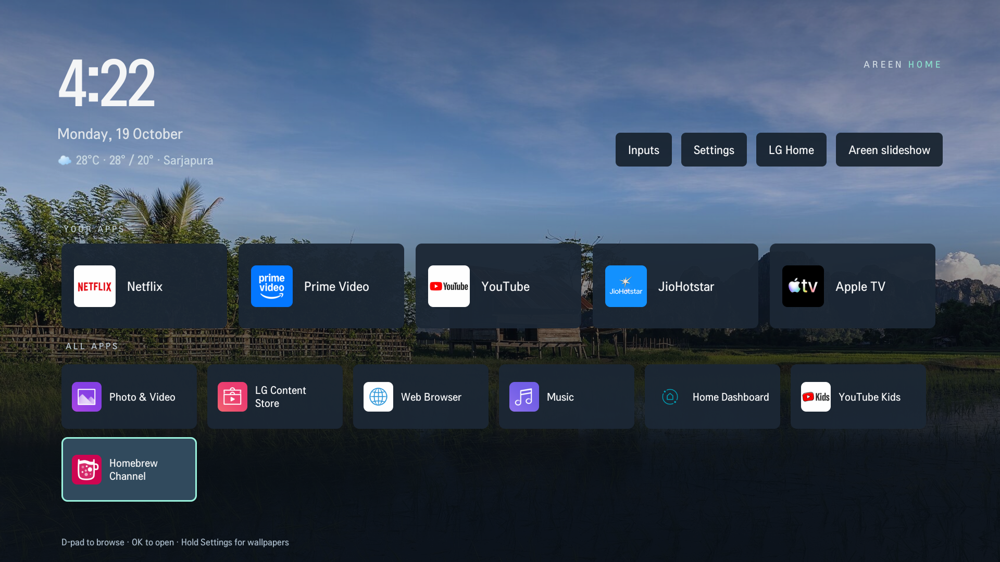
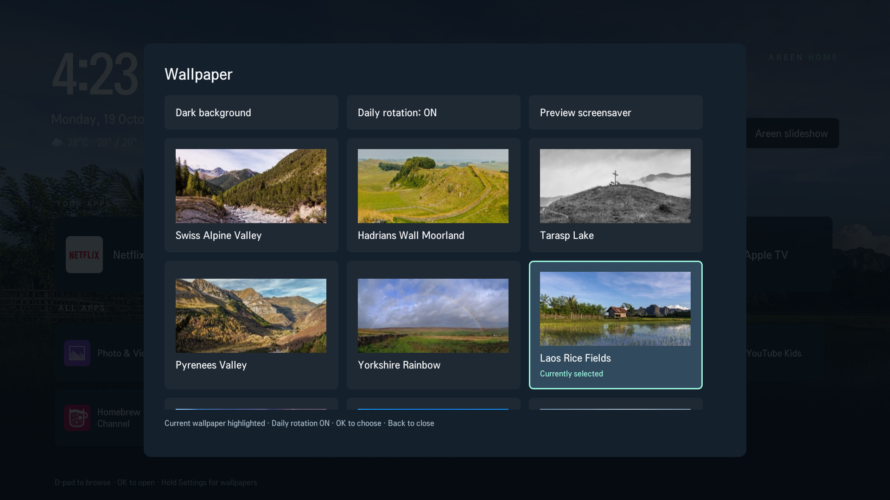
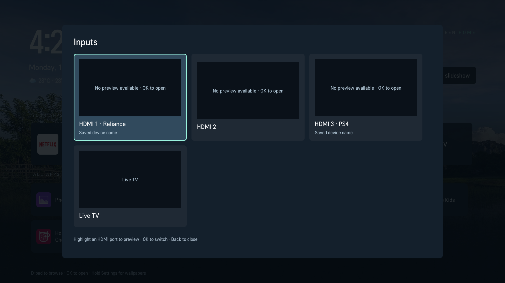

# Screenshots from the original TV

Real, unedited 1920×1080 captures from the original LG 55UM7300PTA setup. They show its configured title, weather location and saved input names; the public reference source uses generic defaults. These captures illustrate the UI improvements before the subsequent overlay trial, not a separately installed build of the generic reference app.

## Home screen

Fixed favourites remain visible while the last app in All Apps is selected. Clock/date, optional weather, Inputs, Settings, stock Home and the immediate slideshow button are visible.

## Wallpaper picker

The displayed wallpaper opens focused and marked **Currently selected**. Daily rotation stays enabled, and the long-press guard prevents the opening OK hold from selecting Dark background.

## Inputs

Empty ports show explicit preview placeholders. Custom input labels are marked **Saved device name**, rather than falsely claiming the device is connected.

## Photo credits and exclusions

Landscape photographs visible behind the UI and in the picker come from Wikimedia Commons. Authors, source links, licenses and presentation changes are listed in [ATTRIBUTION.txt](ATTRIBUTION.txt). The main background is **Basile Morin's photograph of rice fields in Vang Vieng, Laos**, under CC BY-SA 4.0. Photo content retains the stated source licenses; it is not relicensed under the repository's MIT code license.

Family-photo slideshow captures and streaming account/profile screens are deliberately excluded. A slideshow screenshot is not required to use the local-photo feature described in the guide.
